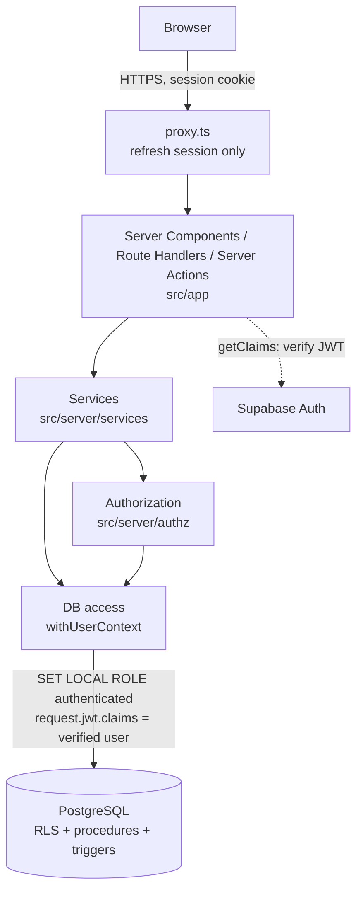

# Architecture

ClubSphere is a **modular monolith**: one Next.js application and one PostgreSQL database serve every organization. Organization isolation is enforced by the database schema and by every server operation, not by running separate copies per club.

## Principles

1. **Club-agnostic.** No club, university, domain, branding or role name appears in code. A club is a row in `organizations`; its roles, questions and rules are rows too. Adding a club is `private.create_organization(...)`, with no deploy.
2. **Identity ≠ membership ≠ authority.** Signing in proves who you are. Membership in a club requires a reviewed request. Authority inside a club comes from that club's roles. Platform administration is a separate table that grants nothing inside clubs.
3. **Defense in depth.** The application checks permissions for clear errors. The database checks again (procedures + RLS + constraints) so a bug in one layer is not a breach.
4. **The database owns invariants.** Uniqueness, tenant consistency, state transitions and auditing are constraints and triggers, so they hold for every code path, including manual SQL.
5. **Boring infrastructure.** Next.js + Supabase (Auth + Postgres). No Redis, queues or microservices until a measured need appears.

## Layers



| Layer | Location | Responsibility |
|---|---|---|
| Proxy | `src/proxy.ts` | Refreshes the Supabase session cookie. **Not** an authorization layer: a proxy can be bypassed (see CVE-2025-29927) or misconfigured. |
| Routes / UI | `src/app` | HTTP and rendering. Calls services; never queries the database directly. |
| Identity | `src/server/auth` | `getVerifiedActor()` verifies the JWT with `getClaims()` and returns a branded `VerifiedActor`. Anonymous sessions count as signed out. |
| Services | `src/server/services` | Use cases. Validate input (Zod), open a user-context transaction, check permission, call a procedure, map errors. |
| Authorization | `src/server/authz` | Permission catalog; `loadOrgAccess()` resolves an organization from its slug and loads the caller's permissions there. |
| Data access | `src/server/db` | Drizzle schema mirror, connection pool, `withUserContext()`. |
| Database | `supabase/migrations` | Tables, constraints, RLS, security-definer procedures, triggers, report views. |

## Request lifecycle (protected operation)

Using "approve a membership request" as the example:

1. **Verify identity.** `requireVerifiedActor()` calls `supabase.auth.getClaims()`, which checks the JWT signature, and returns `{ userId }`.
2. **Validate input.** `ReviewMembershipRequestInput.parse(input)` checks the slug, the uuid and the reason length.
3. **Enter user context.** `withUserContext(db, actor, fn)` opens a transaction, runs `SET LOCAL ROLE authenticated`, and puts the verified user id into `request.jwt.claims` (read by `auth.uid()`). From here, RLS and GRANTs apply exactly as for a Supabase Data API call.
4. **Resolve organization from trusted context.** `loadOrgAccess(tx, slug)` looks the slug up server-side and loads `private.my_org_permissions(org.id)`. A client-supplied organization id is never trusted.
5. **Check permission.** `assertPermission(access, "membership.review")`. The service also confirms the request belongs to that organization, so ids cannot be replayed under another club's URL.
6. **Execute.** `select private.approve_membership_request($id)` locks the organization row, re-checks permission from the request's own organization, locks the request row, verifies it is still pending, creates the membership and the default role, and marks the request approved.
7. **Audit.** Triggers write `membership.created`, `membership_role.created` and `membership_request.status_changed` rows in the same transaction. If anything fails, everything rolls back, including the audit rows.
8. **Map errors.** `handleServiceError()` converts SQLSTATEs into an `AppError` with a user-safe message and logs only codes.

## Directory structure

```
.
├── .github/workflows/ci.yml           lint, typecheck, tests, build, e2e smoke
├── docs/                              this documentation
├── scripts/demo-reports.ts            runs report queries on sample data (no Supabase needed)
├── supabase/
│   ├── migrations/                    SOURCE OF TRUTH for the schema (Supabase CLI format)
│   ├── rollback/                      dev-only down script
│   ├── bootstrap/                     one-time SQL to create the first admin + club
│   └── queries/demo_reports.sql       demonstration queries
├── src/
│   ├── proxy.ts                       session refresh only
│   ├── app/                           routes: /, /auth/callback, /auth/confirm, /auth/error, /api/health
│   ├── lib/                           code safe for both server and browser (public env, supabase clients, safe redirects)
│   └── server/                        server-only code ("server-only" import guard)
│       ├── auth/                      VerifiedActor, getVerifiedActor()
│       ├── authz/                     permission catalog, loadOrgAccess(), assertPermission()
│       ├── db/                        schema.ts (Drizzle mirror), client.ts, user-context.ts
│       ├── services/                  memberships.ts, reports.ts
│       ├── validation/                Zod input + organization config schemas
│       ├── env.ts  errors.ts  log.ts
└── test/
    ├── db/                            PGlite: migrations, RLS, procedures, constraints, audit, reports, drift
    ├── integration/                   service layer through Drizzle on PGlite
    ├── unit/                          auth routes, errors, logging, redirects, config schemas
    ├── concurrency/                   real-Postgres race tests (needs TEST_DATABASE_URL)
    └── e2e/                           Playwright: HTTP smoke now, browser auth flows in Phase 2
```

## Conventions every new module must follow

A Phase 3 module (events, inventory, …) is accepted only if:

1. **Tables** carry `organization_id uuid not null` and expose `unique (organization_id, id)`. Child tables reference parents with **composite FKs** `(organization_id, parent_id)`.
2. **RLS** is enabled with explicit GRANTs. `test/db/migrations.test.ts` already fails if any public table lacks RLS or grants anything to `anon`.
3. **Permissions** are new keys in `public.permissions` (migration) **and** `PERMISSIONS` (TypeScript), granted to every existing owner role in the same migration. Code checks permissions, never role names.
4. **Writes** that span rows or need authorization go through a `private.*` SECURITY DEFINER function with `set search_path = ''`, following the lock → check → write order. Add it to the allow-list in `migrations.test.ts`.
5. **Audit** by attaching `private.audit_row_change('<target>')` to each table.
6. **Feature flag** in `OrganizationSettingsSchema.features` (default off).
7. **Tests** for every forbidden path: cross-organization access, missing permission, suspended member, duplicate/replayed operation.

## Key decisions

| Decision | Choice | Reason |
|---|---|---|
| Schema source of truth | Hand-written SQL migrations (Supabase CLI), with Drizzle used as a typed query builder over a mirrored schema | RLS policies, triggers and procedures must be SQL anyway. The DBMS course requires visible DDL. One migration system avoids drizzle-kit and the SQL files fighting over the same database. A drift test keeps the mirror honest. *Deviation from the brief's "Drizzle migrations".* |
| How the app talks to Postgres | Direct pooled connection; every request inside `withUserContext` (`SET LOCAL ROLE authenticated` + claims) | RLS applies to server queries too, instead of a broad service-role client. |
| Authorization model | Organization-scoped RBAC: roles per org, permissions global | Clubs can rename roles or add custom ones without code. |
| Escalation rule | You can only grant, assign, suspend or revoke what you hold yourself | Stops "officer makes themselves owner" at the database level. |
| Concurrency | `SELECT … FOR UPDATE` on the organization row, then the target row; unique constraints as backstops | Prevents double-approval and write skew (two owners suspending each other) under the default READ COMMITTED isolation. |
| Not-found vs forbidden | Cross-org attempts return "not found" | Officers of club A cannot learn whether a request id exists in club B. |
| Status columns | `text` + `CHECK` instead of ENUM types | Easier to evolve. |
| Test database | PGlite (Postgres 18 in WASM) with a small Supabase shim | Real Postgres semantics (RLS, triggers, plpgsql) with no Docker. Race tests need a real server (`test/concurrency`). |
| TypeScript version | 5.9 (from `create-next-app`); **not** 7.x | `typescript-eslint` supports `<6.1`. TS 7 would break linting. |
| Offline demo mode | `AUTH_MODE=demo`: same app and SQL on a local PGlite database (`.demo-data/`) with signed "sign in as" cookies | Reviews and vivas without Wi-Fi or cloud accounts. Structurally isolated: refuses to start with a `DATABASE_URL` or `APP_ENV=production`. |
| Embeddings | Static Model2Vec model (256-d) computed in the Next.js server | Real semantic search with no GPU, native code or paid API; ~30 MB, deterministic. |
| Default roles | `role_templates` table + `private.register_permission()` | New modules add permissions with one call, which also backfills existing clubs. |

## Open decisions (need your input)

1. **SQL + vector (pgvector) or SQL + NoSQL (MongoDB)?** The synopsis and requirements (Option 2) support pgvector. Your review checklist says "RDBMS + NoSQL". Confirm with the instructor; the MongoDB fallback design is in [DATABASE.md §10](DATABASE.md#10-vector--nosql-component).
2. **Hosting.** Vercel (Next.js) + Supabase is assumed (see [DEPLOYMENT.md](DEPLOYMENT.md)).
3. **Who is the first platform admin**, and the first club's slug, name, email-domain rule and profile questions. These are entered with `supabase/bootstrap/…sql`, not code.
4. **Invite-only onboarding.** The policy value exists and currently *blocks* requests. The invitation flow itself is not built.
5. **Manual identity linking.** Supabase's manual linking (`linkIdentity()`) is beta and off by default. Decide whether to enable it.

## Performance targets (defined, **not yet measured**)

| Operation | Target | How it will be measured |
|---|---|---|
| `GET /api/health` | p95 < 100 ms (same region) | k6, 20 VUs, 2 min |
| Membership procedure call (DB time) | p95 < 50 ms | `EXPLAIN ANALYZE` + k6 against staging |
| Authenticated page server render | p95 < 300 ms | k6 with a session cookie |
| Event check-in scan (Phase 3) | p95 < 500 ms end-to-end at 300 scans/min | k6 scenario simulating 5 scanners |

Load profile assumed for sizing: 10 organizations × 2,000 members, peak 300 check-ins per minute during an event. Indexes are designed for these queries ([DATABASE.md §7](DATABASE.md#7-indexes)). Nothing above has been benchmarked yet.

## Reliability

- **Health check**: `GET /api/health` returns 200/503 with DB reachability; no internals.
- **Structured logs**: JSON lines with event names and codes; credential-like keys redacted at any depth; SQL and parameters never logged.
- **Errors**: users see `AppError.publicMessage` only, never database messages, stack traces or SQL.
- **Transactions** are short: no network calls inside `withUserContext`.
- **Pooling**: Supabase transaction pooler (port 6543), `prepare: false`, small per-instance pool (`DATABASE_POOL_MAX`).
- **Caching**: none of authorization-dependent data. With Cache Components enabled, nothing is cached unless explicitly marked `use cache`.
