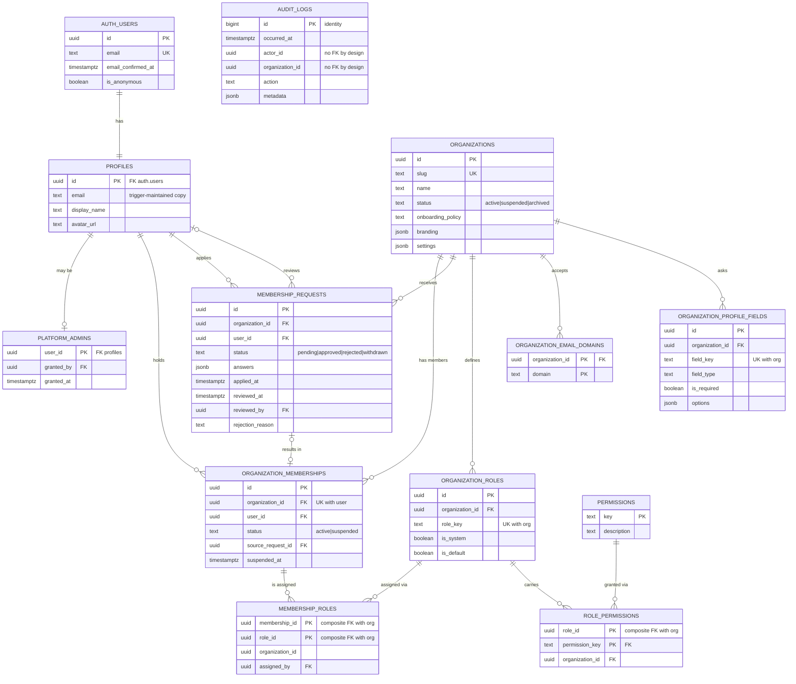
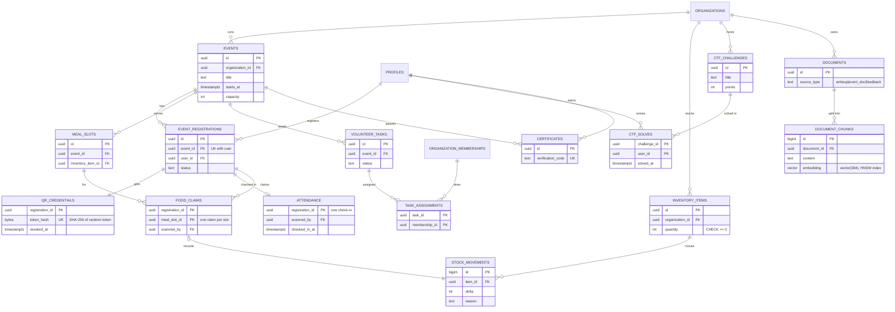

# Database design

The SQL in [`supabase/migrations/`](../supabase/migrations) is the source of truth. This document explains it.

- [1. Database choice and justification](#1-database-choice-and-justification)
- [2. ER diagram: Phase 1 (implemented)](#2-er-diagram-phase-1-implemented)
- [3. ER diagram: full system (Phase 3 modules designed, not yet built)](#3-er-diagram-full-system)
- [4. Relational schema and data dictionary](#4-relational-schema-and-data-dictionary)
- [5. Constraints that enforce business rules](#5-constraints-that-enforce-business-rules)
- [6. Normalization](#6-normalization)
- [7. Indexes](#7-indexes)
- [8. Triggers, functions and procedures](#8-triggers-functions-and-procedures)
- [9. Views and reports](#9-views-and-reports)
- [10. Vector / NoSQL component](#10-vector--nosql-component)
- [11. Migrations and rollback](#11-migrations-and-rollback)

---

## 1. Database choice and justification

The course asks for a choice justified by the shape of the data, not technology for its own sake.

| Data | Store | Why |
|---|---|---|
| Users, organizations, roles, memberships, requests, audit log (Phase 1); events, registrations, attendance, food claims, inventory, stock movements, tasks, certificates (Phase 3) | **PostgreSQL tables** | Highly related data with rules that must never be broken: one membership per person per club, no duplicate food claim, no negative stock. These need foreign keys, unique/check constraints and multi-row **ACID transactions**. Reports need joins and aggregates. |
| Per-club configuration (branding, feature switches), membership application answers whose questions differ per club | **PostgreSQL JSONB** columns | The shape varies by organization. JSONB keeps it flexible while the database still guarantees "is a JSON object", the procedure `private.validate_profile_answers` checks answers against the club's field definitions, and Zod schemas type it in the app. |
| CTF challenge descriptions, write-ups, event documentation, feedback text (Phase 3) | **pgvector** (vector columns in PostgreSQL) | Users need to search by *meaning* ("SQL injection walkthrough" should find a write-up titled "Bypassing a login form"). Keeping vectors next to the relational rows means the same RLS isolation, transactions and joins apply to search, with no second database to keep in sync. |

**Course option used: Option 2 (SQL + vector database)**, matching the approved synopsis. See [§10](#10-vector--nosql-component) for an optional MongoDB component if reviewers require Option 1 (SQL + NoSQL). That is an open decision.

---

## 2. ER diagram: Phase 1 (implemented)

12 tables, all created by the migrations and covered by tests. `auth.users` belongs to Supabase Auth.

**Cardinalities in words**

- A person (profile) can belong to **many** organizations and an organization has **many** members: an M:N relationship resolved by the associative entity `organization_memberships`, which carries its own attributes (status, joined_at, suspension details).
- A membership can hold **many** roles and a role can be held by **many** memberships: M:N via `membership_roles`.
- A role carries **many** permissions and a permission appears in **many** roles: M:N via `role_permissions`.
- An organization **defines** its own roles (1:N). Roles are never shared between organizations.
- A membership request **may result in** at most one membership (1:0..1, `source_request_id`).
- `audit_logs` is deliberately not linked by foreign keys (see §5).

> To export this as an image for slides: paste the Mermaid block into https://mermaid.live and download PNG/SVG. GitHub also renders it directly.

---

## 3. ER diagram: full system

Phase 3 modules from the synopsis, **designed but not yet implemented**. Every table carries `organization_id` and uses composite foreign keys so rows cannot reference another club's data, the same convention as Phase 1.

The key Phase 3 guarantees, and the database mechanism behind each:

| Rule | Mechanism |
|---|---|
| A QR code can't be scanned in twice | `attendance` primary key = `registration_id`, so a second scan raises a unique violation, which the app reports as "already checked in" (idempotent). |
| One food claim per person per meal | `food_claims` primary key `(registration_id, meal_slot_id)`. |
| Food can't be issued when stock is out | `update inventory_items set quantity = quantity - 1 where id = $1 and quantity > 0` plus `CHECK (quantity >= 0)`, in the **same transaction** as the claim insert and a `stock_movements` row. If any step fails, all roll back. |
| QR codes are not guessable or forgeable | 128-bit random token shown as the QR; only its SHA-256 hash is stored, so a database leak does not reveal valid codes. |
| Contribution metrics | Views or materialized views aggregating attendance, task assignments and CTF solves with window functions. |

---

## 4. Relational schema and data dictionary

Notation: **PK** primary key, **FK** foreign key, **UK** unique. Full column definitions are in the migrations.

| Table | Purpose | Key columns and rules |
|---|---|---|
| `profiles` | One per auth user, organization-independent | PK `id` → `auth.users(id)` ON DELETE CASCADE. `display_name` 1–100 chars. `avatar_url` must be https. `email` is a trigger-maintained copy, **not** user-updatable. |
| `platform_admins` | Who may create/suspend organizations | PK `user_id` → profiles. No API write path. |
| `organizations` | A club or organization | PK `id` (uuid). UK `slug` (3–50 chars, `a-z0-9-`, no `--`). `status` ∈ active/suspended/archived. `onboarding_policy` ∈ approval_required/invite_only/closed. `branding`, `settings` JSONB objects. |
| `organization_email_domains` | Optional eligibility rule | PK `(organization_id, domain)`. Domain format CHECK. |
| `organization_profile_fields` | Club-specific application questions | UK `(organization_id, field_key)`. `field_type` ∈ text/long_text/number/select/url. `options` required exactly when type = select. |
| `permissions` | Capability catalog | PK `key` (e.g. `membership.review`). Seeded by migration. |
| `organization_roles` | Roles belonging to one organization | UK `(organization_id, role_key)`, UK `(organization_id, id)` (target for composite FKs). Partial UK: one `is_default` role per org. |
| `role_permissions` | Permissions carried by a role | PK `(role_id, permission_key)`. Composite FK `(organization_id, role_id)` → `organization_roles(organization_id, id)`. |
| `membership_requests` | Applications to join | Partial UK `(organization_id, user_id) WHERE status = 'pending'`. CHECKs tie `reviewed_at`/`withdrawn_at`/`rejection_reason` to `status`. |
| `organization_memberships` | Approved members | UK `(organization_id, user_id)`. `status` ∈ active/suspended. CHECK: suspended ⇔ `suspended_at` set. Composite FK to the source request in the same org. |
| `membership_roles` | Roles held by a membership | PK `(membership_id, role_id)`. Two composite FKs sharing `organization_id`, so membership and role must be in the same org. |
| `audit_logs` | Append-only change history | PK `id` bigint identity. `action` format CHECK. `metadata` object ≤ 4 KB. |

---

## 5. Constraints that enforce business rules

| Business rule | Enforced by |
|---|---|
| A person can't have two memberships in one club | `UNIQUE (organization_id, user_id)` on memberships |
| No duplicate pending requests, even from simultaneous double-clicks | Partial unique index `WHERE status = 'pending'` + procedure catches `unique_violation` and returns the existing request |
| A role from club B can't be attached in club A | Composite FKs on `membership_roles` and `role_permissions` |
| Review metadata matches status (can't be "approved" without a review time) | Multi-column CHECK `membership_requests_review_consistent` |
| A rejection reason only exists on rejected requests | CHECK `membership_requests_reason_only_on_reject` |
| One default role per organization | Partial unique index on `organization_roles (organization_id) WHERE is_default` |
| Audit history can't be edited or deleted | BEFORE UPDATE/DELETE row trigger + BEFORE TRUNCATE statement trigger raise `CS403`; privileges revoked |
| Audit history survives account deletion | **No FK** on `audit_logs.actor_id`. An `ON DELETE SET NULL` would itself be an UPDATE of the log. |
| Deleting a user cleans up their data | `ON DELETE CASCADE` from `auth.users` → `profiles` → requests/memberships; reviewer references use `ON DELETE SET NULL` |

**Why CHECK constraints instead of ENUM types?** Adding or removing allowed values in a CHECK is a simple `ALTER TABLE`. Removing a value from a Postgres ENUM is not supported without recreating the type.

---

## 6. Normalization

The schema is in **3NF**, with two deliberate, controlled exceptions.

- **1NF**: every column holds one value. Roles are not stored as a comma-separated list on the membership; they get their own table (`membership_roles`).
- **2NF**: in tables with composite keys, non-key columns depend on the whole key. `membership_roles.assigned_at` depends on (membership, role) together.
- **3NF**: no non-key column depends on another non-key column. Memberships don't store the organization's name; it is joined from `organizations`.

**Deliberate exceptions (and why they are safe)**

1. `role_permissions.organization_id` and `membership_roles.organization_id` are determined by `role_id` / `membership_id` alone, a partial dependency that technically breaks 2NF. They exist so that a **composite foreign key** can prove both sides belong to the same organization, and so RLS policies can filter without extra joins. They cannot become inconsistent: the composite FK rejects any mismatch, and ids never change.
2. `profiles.email` duplicates `auth.users.email`. It is maintained by a trigger and is never used for security decisions; eligibility checks read `auth.users`.

**JSONB and 1NF.** `membership_requests.answers` is treated as one atomic value: a snapshot of an application form whose questions differ per club. It is never queried relationally. If per-answer reporting were needed, it would be normalized into `request_answers(request_id, field_id, value)`.

---

## 7. Indexes

| Index | Serves |
|---|---|
| `organization_memberships (organization_id, user_id)` UNIQUE | Permission checks (`has_org_permission`), member lists |
| `organization_memberships (user_id)` | "Which organizations am I in?" |
| `membership_requests (organization_id, status, applied_at, id)` | Reviewer queue with keyset pagination: `WHERE org = $1 AND status = 'pending' AND (applied_at, id) > ($2, $3) ORDER BY applied_at, id` |
| `membership_requests (organization_id, user_id) WHERE status = 'pending'` UNIQUE | Duplicate prevention (and a fast lookup) |
| `membership_requests (user_id, applied_at desc)` | Applicant status page |
| `membership_roles (role_id)`, `role_permissions` PK `(role_id, permission_key)` | Joins in `has_org_permission` |
| `audit_logs (organization_id, occurred_at desc)` partial | Audit screen, newest first |
| `audit_logs (actor_id, occurred_at desc)` partial | Investigations by person |

Composite index column order follows the **leftmost-prefix rule**: the queue index starts with `organization_id` because every query is scoped to one organization.

Planned: GIN on `tsvector` for full-text search and **HNSW** (`vector_cosine_ops`) on `document_chunks.embedding`. For very large audit logs, BRIN on `occurred_at` or time partitioning.

---

## 8. Triggers, functions and procedures

**Triggers** ([0200](../supabase/migrations/20261024000200_audit_log.sql) … [0600](../supabase/migrations/20261024000600_memberships.sql))

| Trigger | Timing | Purpose |
|---|---|---|
| `*_set_updated_at` | BEFORE UPDATE, row | Sets `updated_at = now()` |
| `on_auth_user_created` | AFTER INSERT on `auth.users` | Creates the profile (never a membership) |
| `on_auth_user_email_changed` | AFTER UPDATE OF email | Syncs `profiles.email` |
| `organizations_seed_default_roles` | AFTER INSERT on organizations | Creates owner/officer/member roles and their permissions, so a new club needs no code |
| `*_audit` (8 tables) | AFTER INSERT/UPDATE/DELETE, row | Writes `audit_logs` via `private.audit_row_change()`, a SECURITY DEFINER function, with the actor from `auth.uid()` |
| `audit_logs_no_update_delete` / `audit_logs_no_truncate` | BEFORE, row / statement | Makes the log append-only |

**Procedures** (PostgreSQL functions in schema `private`, [0700](../supabase/migrations/20261024000700_authorization_and_procedures.sql))

`request_membership`, `withdraw_membership_request`, `approve_membership_request`, `reject_membership_request`, `suspend_membership`, `reinstate_membership`, `assign_role`, `revoke_role`, `create_organization`, `set_organization_status`.

They are `SECURITY DEFINER` with `SET search_path = ''`, which prevents search-path hijacking. Each one follows the same order: identify the actor → derive the organization from the target row → lock the organization row → check permission → lock and validate the target → write. Audit rows are added by triggers in the same transaction.

We use `CREATE FUNCTION` rather than `CREATE PROCEDURE` because these return values (new ids) and are called with `SELECT`. Transaction control stays with the caller.

---

## 9. Views and reports

All views use `WITH (security_invoker = true)` so RLS on the underlying tables applies to the caller, and they return rows only where the caller holds `analytics.read`.

| View | Shows | SQL features |
|---|---|---|
| `report_org_membership_summary` | Active/suspended members, pending/approved/rejected requests, approval rate | CTEs, `COUNT(*) FILTER`, `LEFT JOIN`, `NULLIF` |
| `report_review_turnaround` | Average / median / max hours to review, per organization | `AVG`, `percentile_cont(0.5) WITHIN GROUP`, `GROUP BY` |
| `report_role_distribution` | Active members per role, including empty roles | `LEFT JOIN` + `COUNT(col)` |
| `report_monthly_applications` | Applications per month by outcome | `date_trunc`, `GROUP BY` |

Further demo queries (HAVING, correlated subquery, `RANK()`, running totals) are in [`supabase/queries/demo_reports.sql`](../supabase/queries/demo_reports.sql). `npm run demo:reports` runs them on sample data.

**Why aggregate in CTEs before joining?** Joining organizations → memberships → requests in one go multiplies rows (memberships × requests per org) and inflates counts. Pre-aggregating each side avoids this "fan-out" problem.

---

## 10. Vector / NoSQL component

### pgvector (planned for Phase 3, matches the synopsis)

| Question the course asks | Answer |
|---|---|
| What becomes an embedding? | CTF challenge descriptions, write-ups, event documents and feedback text, split into chunks of roughly 300–500 tokens |
| Which model? | `gte-small` / `all-MiniLM-L6-v2` class, 384 dimensions, free (Supabase Edge Functions AI inference or transformers.js). Larger hosted models are a drop-in change of dimension. |
| How are vectors stored? | `document_chunks.embedding vector(384)`, alongside `organization_id`, `document_id` and `content`, protected by the same RLS as other org data |
| Similarity metric | Cosine distance (`<=>` operator); similarity = 1 − distance |
| Retrieval | `WHERE organization_id = $org ORDER BY embedding <=> $query LIMIT 10` using an HNSW index; optionally fused with full-text `ts_rank` results (hybrid search, reciprocal-rank fusion) |

### Optional MongoDB (only if the reviewer requires Option 1)

The best fit is **event feedback forms**, where every event defines different questions (ratings, multiple choice, free text, nested sections). Each response is a self-contained document, and reports use the **aggregation pipeline** (`$match` → `$unwind` → `$group`). The trade-offs to state honestly: tenant isolation has to be re-implemented in the app layer (no RLS), and there are no cross-database transactions, so writes would go through an outbox. Core club data stays in PostgreSQL either way.

---

## 11. Migrations and rollback

- Migrations are plain SQL files in Supabase CLI format, applied in filename order. Each runs as one transaction: all of it or none.
- **Forward-only in production.** Mistakes are fixed with a new migration. Before applying a migration to production, take a backup (Supabase PITR on paid plans, or `supabase db dump`).
- [`supabase/rollback/20261024_foundation_down.sql`](../supabase/rollback/20261024_foundation_down.sql) removes the whole Phase 1 foundation for development resets. A test runs *up → down → up* to prove the migrations are reversible and re-runnable on a clean database.
