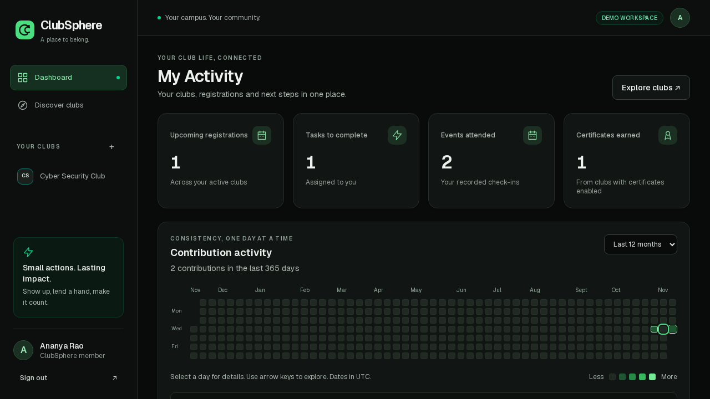

# Black and green workspace

ClubSphere uses a black/charcoal workspace with green interaction states, a persistent desktop sidebar, a collapsible mobile workspace menu, and shared cards, forms and tables. The theme is explicit rather than tied to the operating system. Club colours remain visible in club markers; primary controls and activity intensity use a consistent green palette. QR credentials retain a white backing for scanning, and printed certificates use white paper with black text.

The shared application and demo render the same components. The landing page, authentication entry, personal dashboard, club reports and all modules inherit the new theme. No UI framework, icon package or chart dependency was added.

## Contribution calendars

- **Dashboard → Contribution activity:** the caller's own check-ins, completed volunteer tasks and CTF solves across active club memberships.
- **Club → Reports → Club activity:** actions visible to the caller's club reporting permissions, restricted to that organization. Reports still require `analytics.read`.
- Daily buckets use **UTC**, shown beside the calendar. The initial view covers the last 365 days including today; period controls show 26 or 13 weeks.
- Each source action counts once. Certificates do not add another contribution for an attendance. Intensities represent 0, 1, 2, 3, and 4+ actions.
- Select a day for the source breakdown; use arrow keys to move between days. Long calendars scroll inside their card on small screens. Totals, active days and longest streak apply to the selected period. A zero-activity day breaks a streak.
- Data comes from the existing tables inside `withUserContext`, preserving RLS. Explicit user predicates protect personal calendars even when the user can manage others' records. Disabled task/CTF modules and suspended memberships/clubs are excluded from personal activity.
- Future calendar days and records older than the displayed year are excluded before aggregation. A date series fills missing days with zero; sample intensity is never invented. Sparse demo activity is intentional.

The public landing-page grid is a labelled decorative illustration, separate from authenticated activity.

## Interface review

Scope: shared Next.js/Tailwind shell, cards/buttons, landing and sign-in entry, Dashboard and Reports; existing module workflows checked in Chromium.

| Area | Evidence | Result |
|---|---|---|
| Typography | Desktop/mobile dashboard and reports; consistent Geist, tabular counts and balanced headings | Clear; no extra font dependency |
| Surfaces | Dark cards, green active navigation, white QR backing, responsive sidebar/menu | Mobile header condensed after screenshot review |
| Motion | Colour/transform transitions only; button press state; reduced-motion CSS | No staged entrance or chart animation |
| Icons | Shared inline SVG set using currentColor | Consistent outline weight |
| Performance | Server-aggregated 365-day series; heatmap interaction in a small client component | No chart/icon framework or additional fetch on range changes |

A broad new component framework and decorative fake activity were considered and rejected: the existing components cover the workflows, and authenticated calendars must reflect actual data. Club-specific colour markers are retained while navigation, primary buttons and activity intensity use green.

## Previews and verification

- [Mobile dashboard](screenshots/redesign-dashboard-mobile.png)
- [Club reports](screenshots/redesign-reports-desktop.png) and [mobile reports](screenshots/redesign-reports-mobile.png)
- [Regular sign-in](screenshots/redesign-signin-desktop.png) and [mobile sign-in](screenshots/redesign-signin-mobile.png)
- [Demo sign-in](screenshots/redesign-login-mobile.png) and [landing page](screenshots/redesign-home.png)

Verified on 2026-11-11:

- Single-worker suite: **332 passed, 7 skipped**. Skips cover optional Redis and real PostgreSQL checks; those integrations were not rerun for this redesign.
- Chromium demo workflows: **19 passed**, including heatmap ranges, keyboard controls, mobile navigation, no horizontal page overflow, and consistent colours under either OS theme.
- Final targeted redesign browser check: **1 passed** after the final responsive and skip-link adjustments.
- Production webpack build, lint and typecheck passed.
- Regular sign-in rendered at desktop and 390px mobile widths without page errors or horizontal overflow. Authentication submission was not tested against a live Supabase provider.

The inspected workflows are ready for local review. Safari, Firefox and physical-device checks remain unverified. No dependency, schema migration or deployment was introduced.
