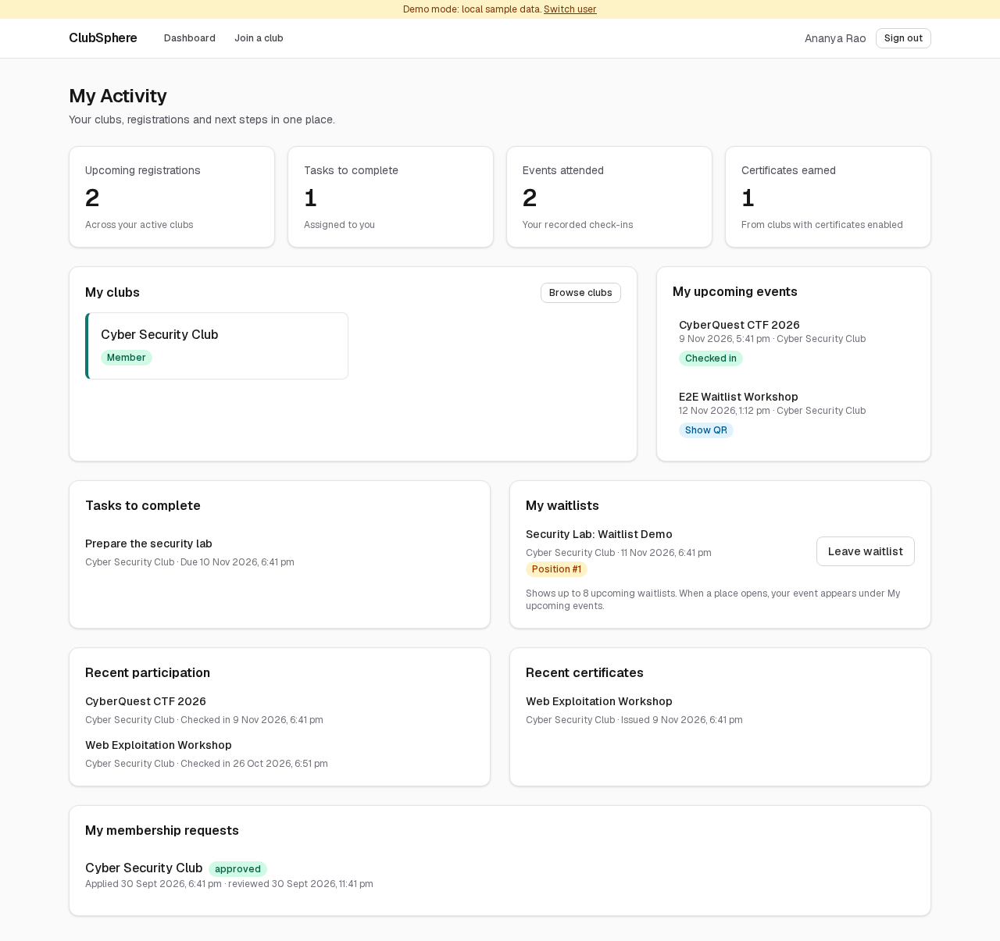
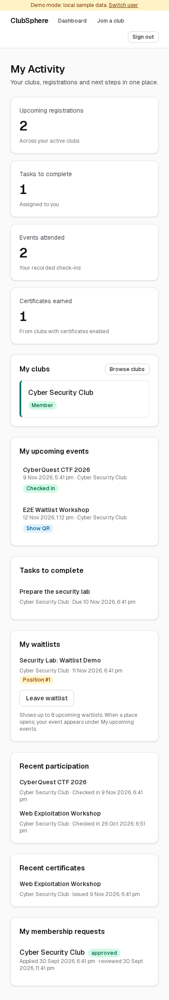
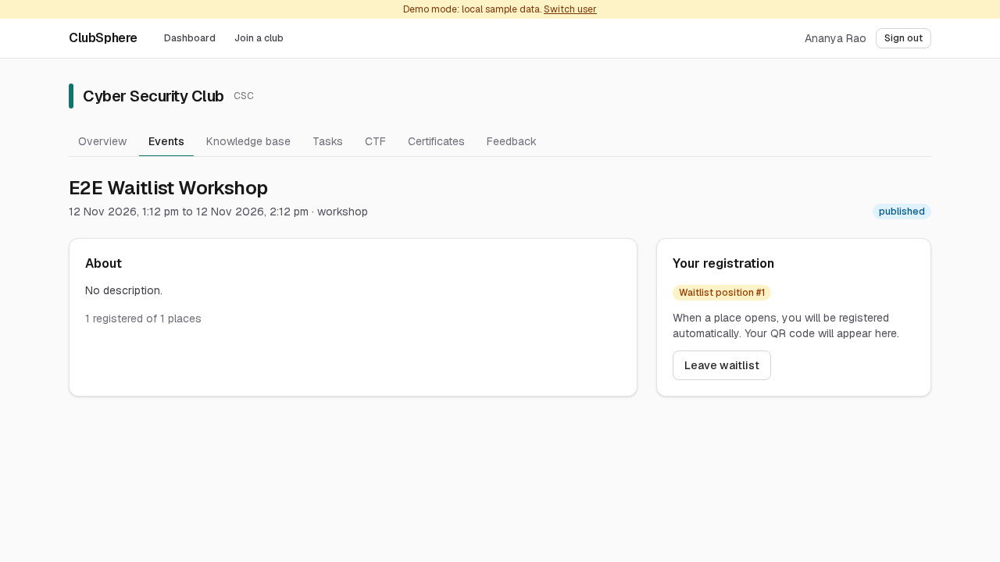
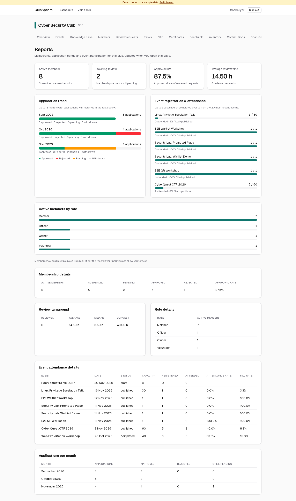
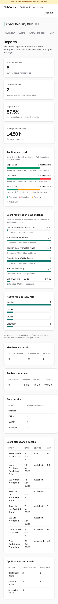

# ClubSphere visual tour

Screenshots use fictional accounts in a local demo database. No cloud account is required: run `npm run demo`, open `/login`, and choose one of the demo identities.

## Ready-to-try demo accounts

- **Ananya Rao:** assigned security-lab task, workshop certificate, recent check-ins, and position **#1** for **Security Lab: Waitlist Demo**.
- **Meera Nair:** position **#2** for the same event.
- **Vikram Singh:** holds that event's only registration. Cancel it to promote Ananya automatically; switch to Ananya to see the registration and private QR.
- **Rohan Gupta:** both clubs, an assigned robotics task, and a private QR for **Security Lab: Promoted Place**, which was already promoted during seeding.
- **Sneha Iyer:** Cyber Security Club → **Reports** for application trends, role breakdowns and filled events.

Existing local demo databases receive these fixtures once on startup (or the next request after development hot reload). They do not need a reset. Later restarts preserve your task edits, queue actions and other demo changes. Disabled modules and changed account permissions are respected.

## Member: My Activity

Open **Dashboard** after signing in. My Activity combines your clubs, upcoming registrations, assigned tasks, waitlists, recent event check-ins and certificates. The counters cover your own records across active memberships. Tasks and certificates follow each club's module settings.

The cards stack on small screens. Task and certificate links open the relevant workflow; leaving a waitlist is also available directly from this page. Lists show bounded previews; club pages contain the full module workflows.

## Member: a full event

Open an upcoming published event with no remaining places and choose **Join waitlist**. Your position appears instead of a QR code. Joining again keeps your place; leaving and rejoining puts you at the back.

When a registration is cancelled before the event starts, the first eligible member is registered in the same transaction. Their registration appears under **My upcoming events**, and the event page shows their private QR and a promotion message. Increasing capacity also fills places from the queue. Suspended memberships are skipped; cancelling or completing the event closes its waiting entries. Promotion stops when the event starts. Updates appear on the next page visit or refresh.

## Officer or owner: Reports

Open a club and select **Reports**. Summary cards show membership, pending requests, approval rate and review time. Application trends, event fill bars and role breakdowns make patterns easier to see; the tables below retain exact figures.

Event visuals show up to six published or completed events from the twenty most recent events. Application visuals show up to twelve months with applications. Figures reflect the records the caller's permissions allow them to view, and members may hold more than one role.

## Reproduce the waitlist demonstration

1. Sign in as an officer, create a future event with capacity **1**, and publish it.
2. Sign in as one member and register.
3. Sign in as a second member and join the waitlist. Check the position on the event and Dashboard pages.
4. Sign in as the first member and cancel the registration.
5. Return as the second member. Open the event to see the automatic registration and private QR.

The automated browser workflow in `test/e2e/demo-flows.spec.ts` exercises these steps, including leaving/rejoining and mobile layouts. Screenshots were captured from the application using that workflow.
